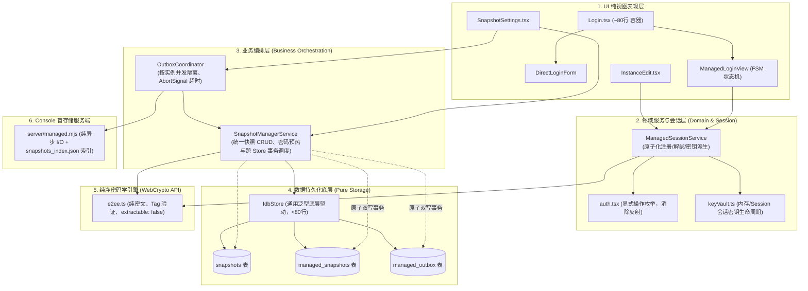

# 架构重构：直连与托管模式全链路分层收敛与治理 (主提案)

**Class:** architecture
**Status:** implemented
**Date:** 2026-10-18
**Source:** 2026-10-18 `$thermo-nuclear-code-quality-review` 专项架构审查；上游提案 `.agents/pipelines/proposals/feature/2026-10-17-console-managed-mode.md`

## Goal

在完成托管模式（Managed Mode）与端到端加密（E2EE）首期落地后，代码质量与架构审查暴露出一批典型的“功能快速演进带来的结构性债务”：
1. **密码学安全红线隐患**：未加密的明文 SHA-256 Checksum 直接暴露在密文 Blob 外层，破坏了盲存储的零知识隔离性，提供了预计算字典碰撞的攻击面；生产密钥被设为 `extractable: true`；
2. **幽灵代码与维护冗余**：Rust 侧维护了 536 行 E2EE 逻辑并引入 6 个 Cargo 依赖，但在生产运行时中未暴露任何 Tauri 命令，是未被调用的冗余实现；
3. **分层崩溃与逻辑渗透**：底层密钥派生（PBKDF2）、远端注册与内存 KeyVault 管理逻辑向 UI 视图层大面积渗透，在 `Login.tsx` 和 `InstanceEdit.tsx` 中出现近百行完全相同的重复代码；
4. **巨石组件与状态拼凑**：`Login.tsx` 膨胀至 600 余行，拥有 17 个平铺 State 变量与脆弱的布尔拼截图渲染；测试用例存在严重的“自证式测试（Mock Theater）”；
5. **存储层非原子双写与循环引用**：快照保存与 Outbox 队列入库分属独立事务，存在永久悬挂 `pending_upload` 的风险；底层数据模块与网络协调模块存在双向强循环引用；
6. **服务端事件循环冻结**：Console 盲存储服务端全量采用同步 I/O，快照列表接口同步读取大体积 Blob，存在冻结 Node.js 单线程事件循环的重大性能隐患。

本提案作为**重构路线主提案**，确立直连与托管模式的统一终态架构分层标准、数据流向模型与事务边界，指导拆分为四个聚焦的子提案分批推进落地。

## Architecture Blueprint

## Sub-proposals Breakdown

本架构重构按依赖关系与风险等级划分为 4 个子提案：

| 子提案 | 类别 | 目标文件 | 核心收益 |
| :--- | :--- | :--- | :--- |
| **子提案 1：E2EE 密码学安全加固与 Rust 幽灵代码下线** | `bug-fix` | `src/lib/crypto/e2ee.ts` `src-tauri/src/crypto.rs` `src-tauri/Cargo.toml` | 拔除明文 Checksum 泄露，锁定密钥不可提取；下线 536 行 Rust 未引用代码，削减 6 个 Cargo 依赖 |
| **子提案 2：存储层 IdbStore 泛型收敛与 Outbox 队列事务化** | `simplification` | `src/lib/snapshot/snapshotStorage.ts` `src/lib/snapshot/outboxSync.ts` `src/lib/snapshot/types.ts` | 抽取通用 `IdbStore<T>` 消除 12 处重复样板（削减 300+ 行）；双 Store 原子提交解决悬挂状态；解除双向循环引用；修复网络超时与实例串扰 |
| **子提案 3：Login 巨石组件拆解与 ManagedSessionService 抽取** | `simplification` | `src/pages/Login.tsx` `src/pages/settings/InstanceEdit.tsx` `src/lib/session/auth.tsx` `src/pages/Login.test.ts` | 建立 `ManagedSessionService` 收敛复制的密码学逻辑；`Login.tsx` 拆为状态机驱动子组件，消除 17 个平铺 State；重写真实行为测试 |
| **子提案 4：服务端盲存储全异步 I/O 与快照元数据索引化** | `bug-fix` | `server/managed.mjs` `server/managed.test.mjs` | 全量迁移至 `node:fs/promises` 消除单线程事件循环冻结；引入 `snapshots_index.json` 实现 $O(1)$ 极速列表；增加并发互斥写队列 |

## Core Principles

1. **零知识纯密文原则**：Console 服务端物理上绝不允许接触任何明文、密码或明文配置的单向散列值（Checksum）；
2. **单一真理来源原则（Single Source of Truth）**：密码学实现以浏览器标准 W3C WebCrypto API 为唯一实现，避免跨语言双轨未消费的维护债务；
3. **单向数据流与事务原子性**：UI 仅表达用户意图，禁止直接编排底层密码学与存储事务；跨 Store 写入必须具备事务原子性或完整的回滚补偿；
4. **测试真实性原则**：严禁在测试中自写业务分支或仅测试原生变量赋值（彻底禁绝 Mock Theater）。

## Accept

- [x] 子提案 1（密码学加固与 Rust 幽灵代码清理）实施完成并全部通过测试
- [x] 子提案 2（存储层 IdbStore 抽取与 Outbox 原子化）实施完成并全部通过测试
- [x] 子提案 3（Login 巨石组件拆解与会话服务抽取）实施完成并全部通过测试
- [x] 子提案 4（服务端异步 I/O 与元数据索引化）实施完成并全部通过测试
- [x] 代码库通过 `pnpm check`、`pnpm test`、`pnpm build`、`npm run test:server`
- [x] 提案校验工具 `node scripts/verify-proposals.mjs` 校验无任何错误

## Note

- 关联子提案 1：`.agents/pipelines/proposals/bug-fix/2026-10-18-managed-e2ee-security-hardening.md`
- 关联子提案 2：`.agents/pipelines/proposals/simplification/2026-10-18-snapshot-storage-atomic-outbox.md`
- 关联子提案 3：`.agents/pipelines/proposals/simplification/2026-10-18-login-monolith-session-service.md`
- 关联子提案 4：`.agents/pipelines/proposals/bug-fix/2026-10-18-managed-server-async-indexing.md`
