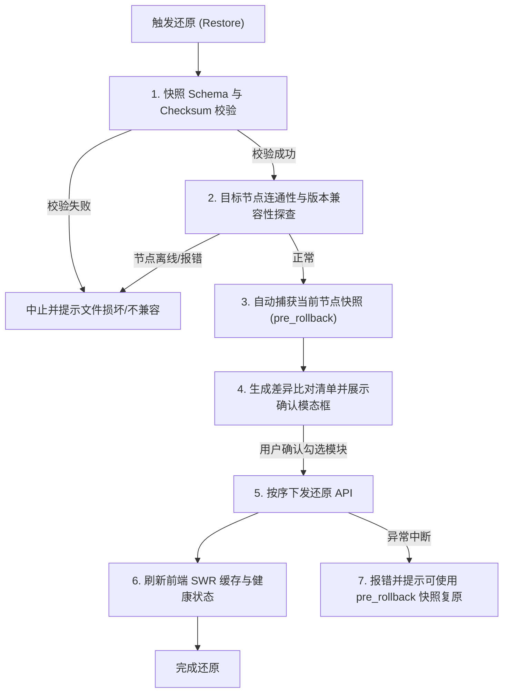

# 配置快照与历史版本还原（Configuration Snapshots & Rollback）

**Class:** feature
**Status:** proposed
**Date:** 2026-10-13
**Source:** 路线图 `2026-10-13-multi-instance-evolution-roadmap.md` P3-1 阶段；解决多实例同步与规则调整缺乏快照备份、无法一键安全回滚的痛点

## Goal

在控制台完成多实例同步能力（P1: 规则、订阅列表、客户端与重写同步）及网络基准测速（P2）后，运维人员在集群环境中的配置变更频次与协同范围显著增加。
然而，在缺乏配置灾备与版本管理机制的现状下，系统存在以下四个致命运维痛点：

1. **多实例同步缺乏回滚保障（Irreversible Sync Risk）**：
   - 现有的 Rules Sync / Filter Lists Sync / Clients Sync 为全量或增量覆盖式推送。一旦用户误将测试节点的空配置同步到生产主节点，或者同步规则存在逻辑冲突，目标节点的历史配置立即被覆盖擦除。由于 AdGuard Home 原生没有配置版本控制或回收站机制，误操作无法挽回。
2. **单机关键参数调优缺乏灾备手段（No Safety Net for Tuning）**：
   - 用户在修改 DNS 上游（Upstream DNS）、阻断模式（Blocking Mode）、DNSSEC、缓存大小或访问控制（ACL）时，一旦参数配置错误可能导致局域网全网 DNS 解析瘫痪。运维人员若忘记原参数组合，往往需要花费大量时间排查重配。
3. **跨设备迁移与灾难恢复成本高（High Disaster Recovery Cost）**：
   - 当遇到软路由重装、硬件迁移或异地备用节点初始化部署时，原生 AGH 需要用户手动通过 SSH/SCP 拷贝 `AdGuardHome.yaml`，或在 Web 界面逐项手动录入，门槛高且极易遗漏细微配置（如自定义标签、客户端独立上游等）。
4. **配置演进与变更过程不可见（No Change History / Audit Trail）**：
   - 无法追溯“上次配置是在何时被谁修改”、“当前配置与一周前相比究竟变动了哪几条重写规则或订阅源”，缺乏历史配置快照与可视化比对能力。

本提案为控制台构建**配置快照与历史版本还原套件（Configuration Snapshots & Rollback Suite）**：
- **快照规范（Snapshot Schema v1.0）**：标准化 AdGuard Home 单机与集群的配置全量/切片导出格式（JSON），内置元数据、防篡改校验码及安全脱敏机制；
- **本地历史版本库（Local Version Vault）**：基于浏览器本地安全存储，支持每次危险操作（多实例同步、批量更新、版本还原）前自动捕获「前置保护快照（Pre-Sync / Pre-Rollback Guard）」，以及用户随时手动创建命名快照；
- **可视化差异比对检查器（Visual Diff Inspector）**：在还原或对比前，直观高亮展示当前运行配置与历史快照之间的字段级差异（新增/修改/删除）；
- **模块化安全还原引擎（Selective & Safe Rollback Engine）**：支持全量覆盖还原或勾选指定模块（如仅还原自定义规则与重写），并在还原执行前执行前置环境校验与二次快照保护，确保变更可控、故障可退。

---

## Decision

### 1. 配置快照数据结构规范 (`src/lib/snapshot/types.ts`)

为了保证快照在不同版本 AGH、浏览器与桌面端之间安全持久化与互通，定义 `AghConfigSnapshot` 规范（v1.0）：

```ts
/** 快照适用的配置模块切片 */
export type SnapshotModule =
  | 'dns'             // 上游DNS、引导DNS、缓存策略、限速、阻断模式等
  | 'filters'         // 广告拦截/白名单订阅列表元数据及开关状态
  | 'user_rules'      // 自定义过滤规则文本列表
  | 'rewrites'        // DNS 重写列表 (domain -> answer)
  | 'clients'         // 静态客户端定义、标签、独立上游、策略覆盖
  | 'access'          // 访问控制列表 (allowed/disallowed/blocked_hosts)
  | 'general'         // 查询日志与统计设置、忽略域名列表
  | 'blocked_services'// 拦截的公共服务 ID 列表及时间表
  | 'safesearch'      // 安全搜索启用状态与引擎开关

/** 快照触发来源 */
export type SnapshotTrigger = 'manual' | 'pre_sync' | 'pre_rollback' | 'scheduled'

export interface SnapshotMeta {
  id: string                     // 唯一 UUID (v4)
  schemaVersion: '1.0'           // 快照协议版本
  createdAt: string              // ISO 8601 时间戳
  label: string                  // 快照展示标题 (如 "同步前自动备份 - 主节点")
  description?: string           // 用户自定义备注
  trigger: SnapshotTrigger       // 触发类型
  sourceInstance: {
    id: string
    label: string
    url: string
    aghVersion: string           // 生成该快照时的 AGH 服务端版本
  }
  modules: SnapshotModule[]      // 本快照包含的模块清单
  checksum: string               // 载荷数据哈希校验码 (SHA-256)，防止文件损坏
}

export interface SnapshotPayload {
  dns?: DnsInfo
  filters?: {
    enabled: boolean
    interval: number
    filters: Filter[]
    whitelist_filters: Filter[]
  }
  user_rules?: string[]
  rewrites?: RewriteEntry[]
  clients?: AghClient[]
  access?: {
    allowed_clients: string[]
    disallowed_clients: string[]
    blocked_hosts: string[]
  }
  general?: {
    querylog: QueryLogConfig
    stats: StatsConfig
  }
  blocked_services?: {
    ids: string[]
    schedule?: unknown
  }
  safesearch?: {
    enabled: boolean
    [engine: string]: boolean
  }
}

export interface AghConfigSnapshot {
  meta: SnapshotMeta
  data: SnapshotPayload
}

/** 集群多实例联合打包快照 (用于整网备份) */
export interface ClusterSnapshotBundle {
  bundleVersion: '1.0'
  createdAt: string
  clusterName?: string
  snapshots: AghConfigSnapshot[]
}
```

#### 安全与脱敏策略 (Security & Sanitization)
- **严格剥离私钥与凭据**：快照生成过程中主动排查 TLS 配置，绝不存储和导出 TLS 私钥（`private_key` 字段强制忽略），也不打包 Web Basic 认证的用户名和密码凭据。
- **只记录配置，不记录状态数据**：不将实时的统计时序数组（`num_dns_queries` 等）和查询日志（Query Log）写入快照，保持快照轻量（单份快照通常在 10KB ~ 200KB 之间），便于快速存储与传输。

---

### 2. 快照捕获与提取服务 (`src/lib/snapshot/snapshotCapture.ts`)

负责从运行中的 AdGuard Home 实例抓取所需模块的完整配置数据并打包：

```ts
/**
 * 抓取当前实例的指定模块配置，组装为符合规范的快照对象
 */
export async function captureInstanceSnapshot(
  cfg: SvrConfig,
  instanceMeta: { id: string; label: string; url: string; aghVersion: string },
  opts: {
    label: string
    trigger: SnapshotTrigger
    description?: string
    modules?: SnapshotModule[] // 省略则抓取全量全部模块
  }
): Promise<AghConfigSnapshot>
```

- **并发拉取**：使用 `Promise.allSettled` 并行请求 `/dns_info`、`/filtering/status`、`/rewrite/list`、`/clients`、`/access/list`、`/querylog/config`、`/stats/config`、`/blocked_services/get`、`/safesearch/status`。
- **校验和生成**：对抓取到的标准化 JSON 字符串生成 SHA-256 校验和并注入 `meta.checksum`。
- **错误降级**：若某一非关键模块在特定固件版本未开启或权限不足，以 warning 形式记录并在 `modules` 中剔除该项，避免阻塞全量快照生成。

---

### 3. 本地快照持久化与版本库 (`src/lib/snapshot/snapshotStorage.ts`)

遵循控制台「前端无状态、本地优先」原则，快照持久化依托客户端本地存储：

- **分层存储设计**：
  - **IndexedDB 存储（主存）**：存储快照完整内容。通过原生 IndexedDB（或轻量封装）构建版本库对象仓库 `agh_snapshots`，按 `createdAt` 降序建立索引。
  - **容量控制与自动淘汰策略（LRU Quota）**：
    - 针对自动保护快照（`pre_sync` / `pre_rollback`）：每个实例保留最近 15 份，超过自动淘汰最早的自动快照；
    - 针对用户手动命名快照（`manual`）：由用户自主管理与删除，默认不限额（上限 100 份）；
    - 总占用限制：预估占用空间不超过 20MB，远低于浏览器 IndexedDB 额度（数 GB）。
- **文件导出与导入（Export & Import）**：
  - **导出**：将选中快照直接触发浏览器下载为 `.agh-snapshot.json`（单机）或 `.agh-cluster-snapshot.json`（集群包）；
  - **导入**：支持用户选择或拖拽本地 JSON 文件，进入预检流程。

---

### 4. 差异比对检查器（Visual Diff Engine: `src/lib/snapshot/snapshotDiff.ts`)

在恢复快照或查看历史版本时，必须对快照与目标节点当前配置进行语义级字段比对，向用户明确展示变更细节：

```ts
export interface DiffItem {
  module: SnapshotModule
  path: string          // 如 "dns.cache_size", "clients['iPhone'].tags"
  label: string         // 国际化友好的字段说明
  oldValue: unknown     // 当前运行中的配置值
  newValue: unknown     // 快照中的目标值
  type: 'added' | 'modified' | 'deleted'
}

export interface ModuleDiffSummary {
  module: SnapshotModule
  hasChanges: boolean
  diffs: DiffItem[]
}

export function computeSnapshotDiff(
  current: SnapshotPayload,
  target: SnapshotPayload,
  modules: SnapshotModule[]
): ModuleDiffSummary[]
```

- **语义级比对规则**：
  - 数组集合比对（如 `user_rules`、`rewrites`、`clients`、`filters`）：不仅比对文本，识别出新增行、修改行与删除行；
  - 核心参数比对：对 `upstream_dns` 列表逐行识别增减，对数值与布尔开关直接对比。

---

### 5. 模块化安全还原与回滚引擎 (`src/lib/snapshot/snapshotRestore.ts`)

还原引擎是整个灾备闭环的核心，必须具备极高的容错性与失败回滚保障：



#### 严格的模块写入顺序与幂等性保证：
1. **DNS 核心与模式设置**：`POST /dns_config`；
2. **阻断服务与时间计划**：`PUT /blocked_services/update`；
3. **安全搜索与访问控制**：`PUT /safesearch/settings`、`POST /access/set`；
4. **过滤器订阅列表**：
   - 比较当前实例已有订阅与快照订阅；
   - 补齐快照中缺失的订阅（`POST /filtering/add_url`）；
   - 对齐现有订阅的开关与名称（`POST /filtering/set_url`）；
5. **用户自定义规则**：`POST /filtering/set_rules`；
6. **DNS 重写规则**：
   - 采用安全比对方式：先增后删，避免中途断开造成记录丢失；
7. **客户端定义**：
   - 已存在客户端调用 `POST /clients/update`，缺失客户端调用 `POST /clients/add`；
8. **通用与日志设置**：`PUT /querylog/config/update`、`PUT /stats/config/update`。

---

### 6. UI / UX 交互与工作流整合

#### A. 独立快照管理界面 (`src/pages/settings/SnapshotSettings.tsx`)
- **入口**：在系统设置或多实例设置中开辟「配置快照与备份（Snapshots & Backup）」专属页面（路由 `/settings/snapshots`）。
- **界面结构**：
  - **顶部操作栏**：当前实例选择器、创建快照按钮（支持自定义备注）、导出全部、导入快照按钮；
  - **快照版本流列表（Version Timeline）**：
    - 按时间倒序展示卡片流；
    - 显著标识快照类型徽标（手动快照 `manual` / 同步保护 `pre_sync` / 还原保护 `pre_rollback`）；
    - 展示包含模块图标标签（DNS、规则、客户端、ACL 等）、创建时间、AGH 固件版本；
    - 卡片右侧动作：**查看详情 / 差异比对**、**一键还原**、**导出文件**、**删除**。

#### B. 差异比对与还原抽屉 (`src/components/snapshot/SnapshotDiffSheet.tsx`)
- 抽屉展示：
  - 快照元信息（创建时间、来源实例、版本）；
  - 模块选择勾选框（支持全选或单选特定模块还原）；
  - 可折叠的字段差异面板：直观展示当前与快照的变更差异，绿色高亮新增规则、黄色高亮修改、红色高亮删除；
  - 底部提供醒目的红色「确认开始还原」按钮（内置二次警示）。

#### C. 同步抽屉防护无缝衔接 (`SyncSheetContent.tsx`)
- 在现有的多实例同步弹窗（Rules Sync、Filter Lists Sync、Clients Sync）中：
  - 增加「执行同步前自动为目标实例备份快照」复选框（默认开启 `checked={true}`）；
  - 同步执行时，底层调用 `captureInstanceSnapshot(..., { trigger: 'pre_sync' })` 并在控制台日志中留下记录；
  - 若同步过程中发现部分目标写入失败，在 Toast 及结果摘要中展示「可在快照管理中一键回退到同步前状态」操作链接。

---

## Scope Boundaries

- **前端轻量化约束**：不引入后端集中式数据库（如 MySQL、PostgreSQL），所有快照数据完全保存在客户端（IndexedDB）与用户下载的 JSON 文件中，严格保持系统的无状态、无服务器门槛优势。
- **敏感私钥安全界限**：快照仅保留可公开配置及策略规则，不打包任何明文私钥或认证凭证，符合安全合规要求。
- **固件跨版本容错界限**：支持不同小版本 AGH（如 v0.107.50 ~ v0.107.79+）之间的快照导入与恢复，遇到目标版本尚未支持的高级特性字段时优雅忽略并生成警告提示，防止 API 400 失败。
- **国际化完整覆盖**：提供中英文双语语言包（`zh/snapshots.ts`, `en/snapshots.ts`），涵盖所有状态徽标、差异比对标签与还原确认文案。

---

## Accept

- [ ] **快照 Schema 与工具库设计**：
  - 定义完整的快照与元数据 TypeScript 类型（`src/lib/snapshot/types.ts`）；
  - 实现全量模块抓取引擎 `captureInstanceSnapshot`，支持并发获取及校验和计算；
  - 编写核心工具库单测，覆盖快照序列化、脱敏与校验和校验。
- [ ] **本地版本库持久化存储**：
  - 实现基于 IndexedDB 的本地快照存储管理类（`src/lib/snapshot/snapshotStorage.ts`）；
  - 支持按实例归类增删查、LRU 自动淘汰机制与导出/导入文件支持。
- [ ] **语义级差异比对引擎**：
  - 实现 `computeSnapshotDiff` 工具函数，支持 DNS、规则、重写、客户端及 ACL 的细粒度差异计算；
  - 补充单元测试，验证新增、修改、删除等各类场景的差异判断准确度。
- [ ] **安全还原与回滚执行器**：
  - 实现 `restoreSnapshot`，具备恢复前自动创建 `pre_rollback` 快照的 Fail-Safe 机制；
  - 支持模块化勾选还原与按序幂等下发，还原后自动刷新 SWR 缓存。
- [ ] **前端 UI 与交互闭环**：
  - 提供 `/settings/snapshots` 快照版本流管理页面与操作界面；
  - 提供 `SnapshotDiffSheet` 差异高亮比对与选择性还原抽屉；
  - 在多实例同步抽屉（`SyncSheetContent.tsx`）中接入同步前自动备份快照开关。
- [ ] **质量门禁与验证**：
  - 通过 `pnpm check`（TypeScript 严格类型检查）；
  - 通过 `pnpm test`（单测全绿，补充针对快照捕获、比对与存储的单元测试）；
  - 方案文档存放在 `.agents/pipelines/proposals/feature/2026-10-13-configuration-snapshots-and-rollback.md`，符合工作流规范。
