# 建立直连与托管模式端到端（E2E）质量闭环

**Class:** testing
**Status:** proposed
**Date:** 2026-10-19
**Source:** 用户 2026-10-19 需求讨论：围绕直连和托管模式建立端到端测试；上游主提案 `.agents/pipelines/proposals/architecture/2026-10-18-managed-mode-architecture-reconstruction.md`

## Goal

在完成直连与托管模式全链路架构分层治理（子提案 1~4 全部落地）后，系统各模块的单元测试与服务端协议测试已实现 100% 通过（182 项 Vitest + 54 项 Node Server）。然而，目前的测试体系在端到端闭环上仍存在关键断层：

1. **破除“Mock 剧场”的最后一道边界**：现有 `src/lib/snapshot/managedE2e.test.ts` 实质是运行在 Node/Vitest 下的内存模拟测试（依赖 `fake-indexeddb`、内存 Mock Fetch 与 localStorage），并未覆盖真实浏览器运行环境（原生 IndexedDB 事务并发、原生 W3C WebCrypto API 硬件加速与密钥生命周期、真实 HTTP 网络交互、跨 Tab/跨 Context 会话隔离）；
2. **零知识安全红线缺乏物理黑盒断言**：架构红线明确规定“Console 服务端绝不持有或接触 AGH 密码明文及未加密配置”。目前缺乏在真实网络层监听并阻断潜在明文泄露的端到端黑盒拦截器；
3. **双设备同步与离线 Outbox 缺乏跨环境实测**：托管模式的核心价值是“设备 A 托管登记并生成快照 -> 设备 B 凭密码激活并解密拉取”，以及“断网离线保存 -> 恢复网络自动补传”。此类强时序、跨会话的场景唯有端到端测试能够提供真实的质量背书。

本提案旨在建立轻量级、确定性、高 ROI 的端到端测试闭环，补齐质量金字塔最顶层的集成验证能力。

## Decision

### 1. 测试框架选型与轻量化基建

- **运行框架**：激活项目 `devDependencies` 中已预装的 `playwright`（`^1.63.0`），补充根目录 `playwright.config.ts`；
- **浏览器运行时**：本地开发与 CI 统一使用单浏览器 **Headless Chromium**，保证毫秒级启动与确定性执行（单次全量执行时间控制在 15 秒内）；
- **服务拉起模式**：利用 Playwright 的 `webServer` 配置或前置脚本，自动启动本地 Vite 前端与纯异步 Node 托管服务端（随机端口，隔离的临时数据目录，测后自动清空），零外部数据库依赖。

### 2. 核心场景设计（3 大黄金路径）

```mermaid
flowchart TD
  subgraph Scenario1 ["场景 1：模式互斥与存储隔离"]
    DirectTab["/login 页面切换直连"] --> DirectSubmit["直连登录并保存实例"]
    DirectSubmit --> AssertDirect["断言：localStorage 有效且绝无 /api/managed/* 网络请求"]
  end

  subgraph Scenario2 ["场景 2：双设备跨端同步与零知识黑盒断言"]
    ContextA["Browser Context A (模拟设备 A)"] --> RegisterA["登记托管实例并生成快照"]
    RegisterA --> SniffA["网络哨兵监听：断言 Payload 仅含 Ciphertext，密码/明文绝对零暴露"]
    SniffA --> ContextB["Browser Context B (模拟设备 B)"]
    ContextB --> ActivateB["获取实例列表 -> 输入密码激活"]
    ActivateB --> DecryptB["自动拉取快照并成功在前端解密还原 DNS 规则"]
    ContextB --> WrongPwdCase["反向用例：错误密码激活 -> UI 优雅报错，严禁脏数据入库"]
  end

  subgraph Scenario3 ["场景 3：离线 Outbox 韧性与网络恢复补传"]
    Offline["context.setOffline(true) 模拟断网"] --> SaveSnap["保存本地快照"]
    SaveSnap --> CheckOutbox["断言：IndexedDB 标记 pending_upload，任务入 Outbox 队列"]
    Online["context.setOffline(false) 恢复网络"] --> AutoSync["触发同步 -> 服务端接收快照 -> Outbox 队列清空"]
  end
```

- **场景 1：直连与托管模式隔离性验证（Mode Isolation Flow）**：
  - 验证登录页直连/托管 Tab 切换时的 FSM 状态机重置；
  - 直连模式登录成功并持久化至本地存储，硬性断言在此过程中绝无任何 `/api/managed/*` 接口请求产生。
- **场景 2：双设备零知识跨端同步与黑盒网络嗅探（Multi-Device Zero-Knowledge Sync）**：
  - **设备 A**：新建 Browser Context A，执行托管实例登记，生成一份包含真实规则的测试快照；
  - **网络哨兵拦截断言**：在 Playwright 层面监听所有向 `/api/managed/*` 发起的 POST/PUT 请求，进行全载荷正则表达式匹配，断言 100% 不包含 AGH 密码明文和未加密规则明文；
  - **设备 B**：新建完全独立的 Browser Context B（模拟全新设备），访问托管服务端列出实例，输入正确 AGH 密码进行激活，验证从服务端拉取的加密快照被成功解密并完整还原；
  - **错误密码反脆弱**：在 Context B 中输入错误密码，验证前端能够捕获 WebCrypto Tag 校验失败，UI 展现优雅错误提示，禁止向本地 IndexedDB 写入损坏快照，亦无未捕获的 Unhandled Promise Rejection。
- **场景 3：网络离线韧性与 Outbox 自动补传（Offline Resilience Flow）**：
  - 通过 `context.setOffline(true)` 模拟设备离线环境，触发一次配置快照保存；
  - 验证本地快照即刻落库且标记为 `pending_upload`，Outbox 事务队列表新增待上传任务；
  - 恢复网络 `context.setOffline(false)` 并触发同步协调器，断言 Outbox 任务完成清空，服务端成功持久化该加密快照文件。

### 3. 边界与反过度设计准则

1. **绝对禁绝外部重量级容器依赖**：
   - 直连模式绝不依赖启动外部真实 AdGuard Home 容器（避免端口冲突、Docker 依赖与 CI 变慢）；直连模式的上游交互复用项目已有的轻量 Mock 契约或代理桩；
2. **拒绝脆弱的像素级视觉与微交互断言**：
   - E2E 仅基于状态机、无障碍标签（`getByRole` / `getByLabel`）、网络请求与存储数据进行确定性断言，不绑定细节 CSS 样式与繁琐动画；
3. **数据严格沙箱化**：
   - 服务端数据目录指向 `os.tmpdir()` 下的独立随机目录，测试套件 `afterAll` 彻底清理，不污染本地开发环境或留下脏数据。

### 4. 门禁集成与命令规划

- 在 `package.json` 中配置：
  - `"test:e2e": "playwright test"`
  - `"test:e2e:ui": "playwright test --ui"`
- 在 `.github/workflows/ci.yml` 中新增 E2E 验证步骤，确保 PR 与主干合入时自动执行。

## Accept

- [ ] 根目录建立 `playwright.config.ts`，配置轻量化 Headless Chromium 运行环境与 WebServer 自动拉起机制
- [ ] 编写并跑通场景 1：直连模式登录与托管模式互斥隔离性端到端测试
- [ ] 编写并跑通场景 2：双设备（Dual-Context）跨端同步与零知识密码安全黑盒嗅探端到端测试
- [ ] 编写并跑通场景 2 反向用例：错误密码激活时解密安全防御与 UI 优雅容错测试
- [ ] 编写并跑通场景 3：断网离线 Outbox 队列暂存与网络恢复自动补传端到端测试
- [ ] `package.json` 补充 `test:e2e` 脚本，全量 E2E 测试在本地运行时间稳定在 15 秒以内
- [ ] `.github/workflows/ci.yml` 集成 Playwright 依赖安装与 `pnpm test:e2e` 执行门禁
- [ ] 提案校验工具 `node scripts/verify-proposals.mjs` 校验通过

## Note

- 上游架构提案：`.agents/pipelines/proposals/architecture/2026-10-18-managed-mode-architecture-reconstruction.md`
- 现存单元测试参考：`src/lib/snapshot/managedE2e.test.ts`、`server/managed.test.mjs`
- 现有服务端代码：`server/managed.mjs`、`server/index.mjs`
- 架构设计规范：`docs/architecture/frontend.md`（存储模型与实例归属）
