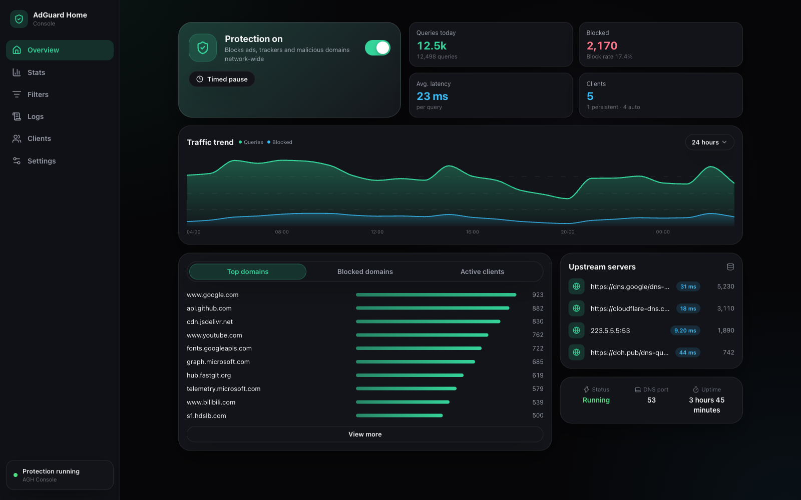
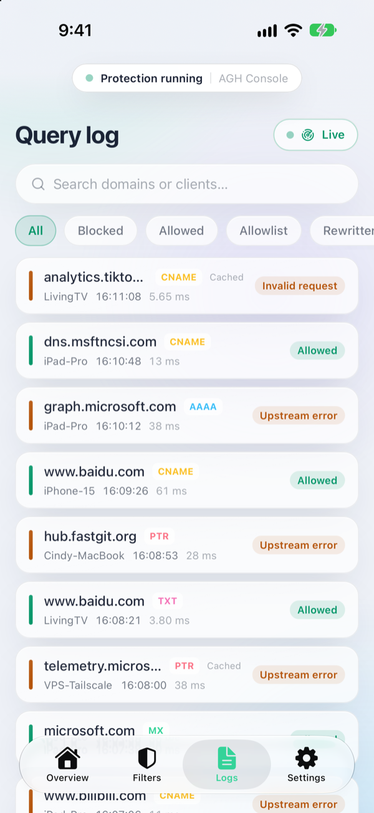
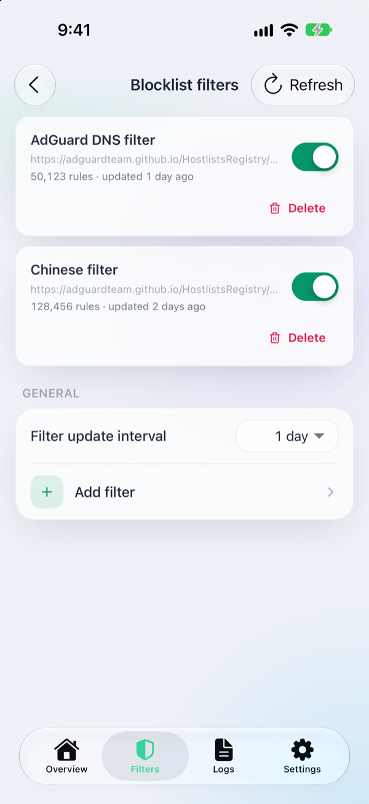
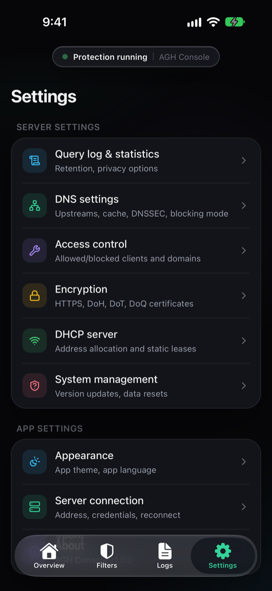

<div align="center">


# AdGuard Home Console

**A modern, cross-platform web console for [AdGuard Home](https://github.com/AdguardTeam/AdGuardHome).**

Full management UI in your browser, as a PWA on your phone, or in a native shell on desktop and mobile — English & 简体中文, light & dark.

**AGH Console** is the app's product name — it is what the browser tab, the desktop window and your phone's home screen show. The npm package and the container image are published as `agh-console`; "AdGuard Home Console" is this repository's project name.

English | [简体中文简介](docs/assets/README.zh-CN.md)

[](https://github.com/Cowjiang/adguard-home-console/actions/workflows/release.yml)
[](https://github.com/Cowjiang/adguard-home-console/releases)
[](#license)
[](https://nodejs.org)



</div>

## Why

AdGuard Home has no CORS headers, so a browser cannot talk to its API directly — every third-party "cloud console" for it needs a middleman server that sees your credentials. AdGuard Home Console flips that around: you run a tiny stateless server yourself, and your username and password never leave your machine.

- **Self-hosted by design** — the Express server only serves static files and reverse-proxies `/api/agh/*` to your AdGuard Home. No accounts, no telemetry, no third party in the middle.
- **Runs anywhere** — one Node process serves the UI and the proxy; expose it to your LAN, your VPN (Tailscale, EasyTier), or keep it on localhost.
- **Built for the current API** — targets the AdGuard Home v0.107.79 HTTP API (`POST /control/protection`, `PUT /querylog/config/update`, …), with partial compatibility for legacy structures.

## Features

- **Overview** — protection toggle with timed pause, query/blocked statistics, 24h traffic trend, top domains & clients, upstream latency and uptime
- **Query log** — live scrolling (2s polling), filter by result or DNS type, search by domain/client, detail overlay with one-click block/allowlist
- **Filters** — blocklist & allowlist management, custom filtering rules with a rule checker, blocked services, DNS rewrites, Safe Browsing / parental control / SafeSearch
- **Clients** — persistent clients with per-client filtering policies, promote auto-detected clients in one click
- **Settings** — query log & statistics retention and anonymization, full DNS configuration with upstream testing, access control, TLS encryption, DHCP server
- **UX** — light/dark/auto theme, English & 简体中文, installable as a PWA with pull-to-refresh on mobile

## Getting started

### Docker

```bash
docker run -d --name agh-console -p 8787:8787 ghcr.io/cowjiang/agh-console:latest
```

Multi-arch (amd64 / arm64). A stable `vX.Y.Z` tag publishes `latest`, `X.Y.Z` and `X.Y`; the nightly built from `dev` publishes `nightly` and `sha-<commit>`. The image is stateless — nothing to mount. To prefill the login page, pass `-e AGH_DEFAULT_URL=http://192.168.1.2:3000`.

The GHCR package inherits the repository's visibility: while the repository is private, `docker login ghcr.io` (token with `read:packages`) is required; switching the package to public in its settings removes that step.

Or with Docker Compose:

```yaml
services:
  agh-console:
    image: ghcr.io/cowjiang/agh-console:latest
    container_name: agh-console
    restart: unless-stopped
    ports:
      - "8787:8787"
    # environment:
    #   AGH_DEFAULT_URL: http://192.168.1.2:3000
```

### npx

Requires Node.js ≥ 24. The package ships the built UI together with the server, so it starts the same process as the other channels:

```bash
npx agh-console
PORT=9000 npx agh-console     # configuration goes in the environment
```

Stable versions sit on the default `latest` dist-tag; the nightly from `dev` is on `nightly` (`npx agh-console@nightly`).

### Release tarball

Download `agh-console.tar.gz` from the [latest release](https://github.com/Cowjiang/adguard-home-console/releases), then:

```bash
mkdir agh-console && cd agh-console
tar xzf /path/to/agh-console.tar.gz
pnpm install --prod
pnpm start
```

### Build from source

Requires Node.js ≥ 24 and pnpm (`corepack enable` is enough; both versions are pinned in `package.json`).

```bash
git clone https://github.com/Cowjiang/adguard-home-console.git
cd adguard-home-console
pnpm install

pnpm dev:all                 # development: frontend on 5173, proxied to the server on 8787
pnpm build && pnpm start     # production: built assets served by Express on 8787
```

Open **http://localhost:5173** (development) or **http://localhost:8787** (production) and enter your AdGuard Home address, username, and password.

## Configuration

All environment variables are optional. The server also reads a `.env` file in the project root when it runs from a source checkout or an unpacked tarball; under npx or Docker, pass the variables in the environment.

| Variable | Default | Description |
| --- | --- | --- |
| `PORT` | `8787` | HTTP listen port |
| `HOSTS` | all interfaces | Comma-separated bind addresses or interface names (e.g. `127.0.0.1,tailscale0`); interface names re-resolve on address change |
| `AGH_DEFAULT_URL` | — | Prefills the AGH address on the login page; switching instances is just entering another address |

### Access from your LAN

On a phone or another device in the same network, open `http://<COMPUTER_IP>:8787` and use **Add to Home Screen** for a full-screen app experience.

## How it works

```
Browser ──┬── static assets (dist) ──────────────── Express (8787)
          └── /api/agh/* ── forwarded ──▶  AdGuard Home /control/*
                 (target set via the X-AGH-Target header,
                  Authorization Basic passed through,
                  same-host 308 redirects followed automatically)
```

Credentials are stored only in your browser's `localStorage`; requests are forwarded by your own local server and never pass through a third party.

## Native shells

The same repository carries a [Tauri 2](https://tauri.app) shell for desktop and iOS/Android packaging, including a Rust proxy and this repo's own Tauri plugins (native glass header components, pull-to-refresh, and more). See [docs/native-platforms.md](docs/native-platforms.md) for platform details.

<div align="center">
  
  
  
  <br />
  <sub>iOS app — live query log, blocklist filters, settings</sub>
</div>

## Development

```bash
pnpm check           # typecheck (TypeScript strict)
pnpm test            # unit tests (vitest)
pnpm build           # production build
```

Rust-side tests: start the contract mock first, then run cargo test — cases that depend on the mock exit silently when it is not running:

```bash
node scripts/mock-agh.mjs &
cd src-tauri && cargo test
```

Bug reports and pull requests are welcome — open an [issue](https://github.com/Cowjiang/adguard-home-console/issues) with your AdGuard Home version and the console logs.

## Disclaimer

This project is an **unofficial** client for AdGuard Home. It is not affiliated with, endorsed by, or sponsored by AdGuard. "AdGuard" and "AdGuard Home" are trademarks of their respective owners; this project only uses their names to describe what it manages.

## License

[Apache-2.0](LICENSE) with the [Commons Clause](LICENSE).

The source is open: personal and non-commercial use — including self-hosting for your family or team — is free. What it does not grant is selling the software itself, or offering paid hosting/support services whose value comes from its functionality, without the author's permission. See [LICENSE](LICENSE) for the full text.

## Acknowledgements

- [AdGuard Home](https://github.com/AdguardTeam/AdGuardHome) — the network-wide ads & trackers blocking DNS server this console manages
- Built with [React](https://react.dev), [Vite](https://vite.dev), [Tailwind CSS](https://tailwindcss.com), [Express](https://expressjs.com), [SWR](https://swr.vercel.app), and [Tauri](https://tauri.app)
