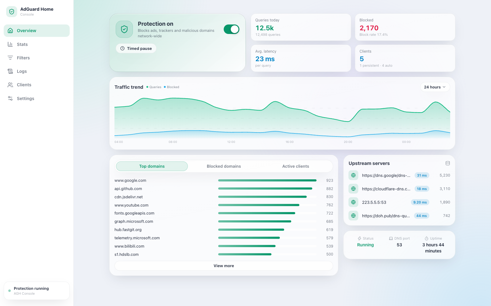
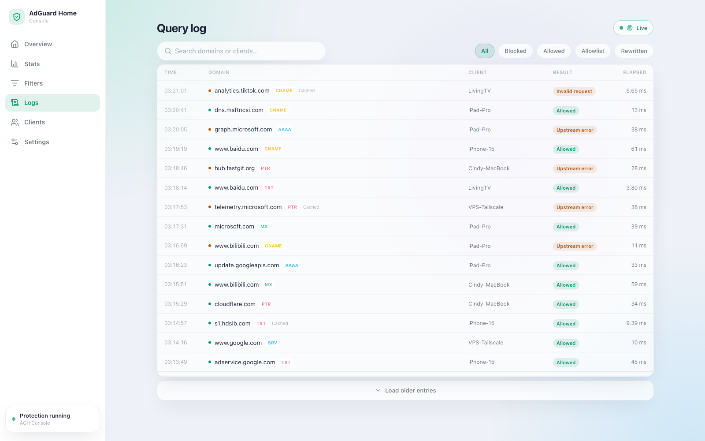
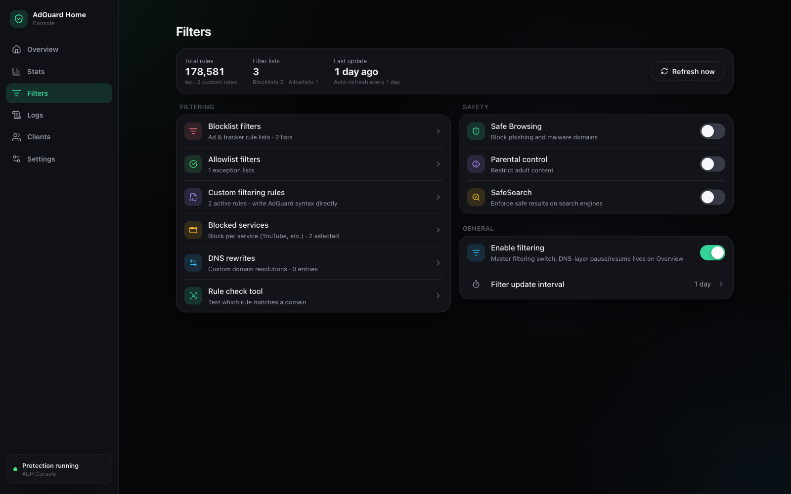

# AdGuard Home Console 简介

**Status:** current
**Updated:** 2026-10-21

AdGuard Home Console 是一个**非官方**的 [AdGuard Home](https://github.com/AdguardTeam/AdGuardHome) 跨平台管理控制台：完整管理界面跑在浏览器里，也可以作为 PWA 装到手机桌面，或打包成桌面与移动端的原生应用。界面提供英文与简体中文、浅色与深色主题。

**AGH Console** 是应用本身的名字：浏览器标签页、桌面窗口标题与手机桌面图标都用它。npm 包名与镜像名是 `agh-console`，「AdGuard Home Console」是本仓库的项目名。

## 为什么有这个项目

AdGuard Home 的 API 不返回 CORS 头，浏览器无法直连——所有第三方「云端控制台」都必须经过一台能看到你凭据的中转服务器。AdGuard Home Console 彻底反转了这种架构，提供完全自托管、由用户掌控的连接形态：

- **直连与托管双形态**：
  - **直连模式**（默认）：纯无状态连接。Express 服务只做静态文件托管和 `/api/agh/*` 反向代理。凭据与快照严格保留在当前浏览器本地（`localStorage` / `IndexedDB`），服务端零磁盘写入。
  - **托管模式**：端侧零知识加密（E2EE）盲存储（`/api/managed/*`）。配置快照在客户端经 AES-256-GCM 加密后再上传，实现跨浏览器、桌面端与移动端（iOS）的安全同步与实例清单管理。服务端仅持久化密文信封与 Salt 元数据，物理上杜绝接触明文密码或配置细节。
- **自托管优先**：没有账号体系、没有遥测、没有第三方中转。
- **随处运行**：一个 Node 进程同时提供 UI、代理与可选的盲存储，可以暴露给局域网、VPN（Tailscale、EasyTier），也可以只留在本机。
- **对齐当前 API**：面向 AdGuard Home v0.107.79 的 HTTP API（`POST /control/protection`、`PUT /querylog/config/update` 等），对旧版结构保持部分兼容。

## 界面预览

概览页提供防护开关与定时暂停、今日查询/拦截统计、24 小时流量趋势、热门域名与客户端、上游延迟与运行状态。




查询日志支持实时滚动（2 秒轮询）、按结果与 DNS 类型过滤、域名/客户端搜索，详情浮层内可一键加入黑白名单。



过滤器页集中管理黑白名单、自定义规则、拦截服务、DNS 改写与安全搜索/家长控制。



打包为原生 iOS 应用（Tauri 2 外壳）后：底部玻璃标签栏、原生返回手势与下拉刷新，界面语言跟随系统（截图为英文系统下的效果）。

<div align="center">
  
  
  
</div>

## 功能速览

- **直连与托管双模式**：客户端纯无状态直连（零服务端磁盘写入），或基于端侧零知识加密（E2EE）的托管模式（多端快照同步与离线 Outbox 队列）
- **概览**：防护开关与定时暂停、查询/拦截统计、24 小时趋势图、热门榜单、上游延迟与运行时长
- **查询日志**：实时滚动、多维度过滤、搜索、详情浮层、一键黑白名单
- **过滤器**：黑白名单管理、AdGuard 语法自定义规则与规则检查工具、拦截服务、DNS 改写、Safe Browsing / 家长控制 / SafeSearch
- **客户端**：持久客户端与按客户端过滤策略，自动发现的客户端可一键转持久
- **设置**：日志与统计的保留期和匿名化、完整 DNS 配置与上游测试、访问控制、TLS 加密、DHCP 服务端
- **体验**：浅色/深色/跟随系统主题、中英双语、可安装为 PWA，移动端支持下拉刷新

## 快速上手

三种部署通道任选其一，详细配置见英文 [README](../../README.md)：

### Docker（amd64 / arm64）

**直连模式（纯无状态，无需挂载卷）：**

```bash
docker run -d --name agh-console -p 8787:8787 ghcr.io/cowjiang/agh-console:latest
```

**托管模式（挂载数据卷以持久化加密快照与实例元数据）：**

```bash
docker run -d --name agh-console -p 8787:8787 \
  -v agh-data:/app/data \
  ghcr.io/cowjiang/agh-console:latest
```

- **直连模式**下容器完全无状态，不需要挂载卷。
- **托管模式**下建议将容器卷挂载到 `/app/data`，以便在容器重启或更新升级后持久化端到端加密快照与实例清单。
- 如需在登录页预填默认地址，传入 `-e AGH_DEFAULT_URL=http://192.168.1.2:3000`。

或使用 Docker Compose：

```yaml
services:
  agh-console:
    image: ghcr.io/cowjiang/agh-console:latest
    container_name: agh-console
    restart: unless-stopped
    ports:
      - "8787:8787"
    volumes:
      # 直连模式可选；托管模式（E2EE 盲存储）建议挂载
      - agh-data:/app/data
    # environment:
    #   AGH_DEFAULT_URL: http://192.168.1.2:3000
    #   AGH_DATA_DIR: /app/data

volumes:
  agh-data:
```

### npx（Node ≥ 24）

稳定版走 latest tag，dev 分支的每日构建走 nightly tag：

```bash
npx agh-console
PORT=9000 npx agh-console     # 端口等配置通过环境变量传入
```

### 源码运行（Node ≥ 24 + pnpm）

```bash
git clone https://github.com/Cowjiang/adguard-home-console.git
cd adguard-home-console && pnpm install
pnpm dev:all                 # 开发：前端 5173，代理到 8787
pnpm build && pnpm start     # 生产：Express 在 8787 托管构建产物与代理
```

启动后打开 <http://localhost:8787>，填入 AdGuard Home 地址与账号密码即可。局域网设备访问 `http://<电脑 IP>:8787` 并「添加到主屏幕」可获得全屏体验。

## 声明与许可

本项目与 AdGuard 官方无关联、未获背书。「AdGuard」与「AdGuard Home」是其各自所有者的商标。源码以 [Apache-2.0 with Commons Clause](../../LICENSE) 发布：个人与非商业使用免费，未经许可不得销售本软件或基于其功能提供付费服务。
